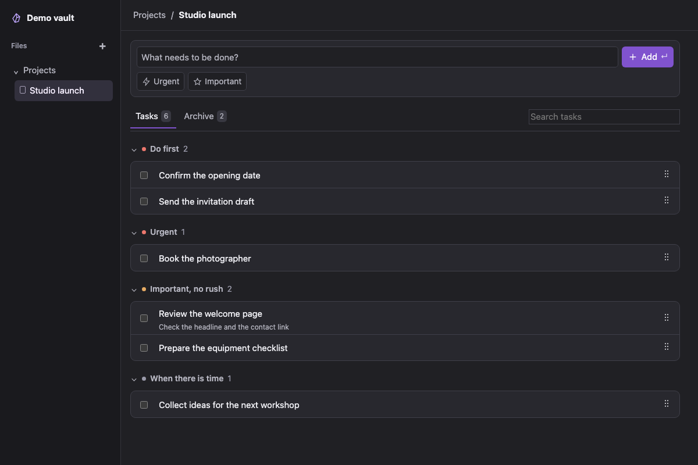

# Zadachi

English · [Русский](README.ru.md)

Mark tasks **Urgent**, **Important**, or both. Zadachi sorts them into four groups so you can see what to tackle first.



Screenshots and demos use sample tasks in a browser preview.

## Install

In Obsidian, open **Settings → Community plugins → Browse** and search for **Zadachi**. Select **Install**, then **Enable**.

[Zadachi in the Obsidian catalog](https://community.obsidian.md/plugins/zadachi)

Requires Obsidian 1.8.7 or later. Tested on macOS and in an Android 11 emulator with Obsidian 1.8.7. iOS has not been tested.

## Create your first list

1. Right-click a folder in the file explorer and choose **Create task list**. You can also run **Zadachi: Create task list** from the command palette.
2. Enter a name, such as **Studio launch**. Zadachi creates a Markdown note in that folder and opens the task view.
3. Type a task and press **Enter** or choose **Add**. Use **Urgent** and **Important** to place it in a priority group.


## Reorder tasks

Drag a task by the six-dot handle within its priority group. The gap shows where the task will land. With the handle focused, use **Alt + ↑** or **Alt + ↓** to move it. To change its group, click the task title and edit its priority.


## Complete and find tasks

- Click a task title to edit its name, priority, or optional note.
- Tick a task to move it to **Archive**. Untick it there to return it to **Tasks**.
- Delete one archived task or clear the archive after confirmation. **Undo** is available for seven seconds.
- Search by title or note in the current tab. Click a priority group's heading to collapse or expand it.

## Where tasks are stored

Each list is a separate `.md` note. Obsidian's file explorer can move or rename it. To see its source, choose **Open as Markdown** from the tab menu. Preserve the generated markers when editing the source.

When no task list is open, the Zadachi ribbon button opens the default list. Change its location in **Settings → Zadachi**. You can also choose English, Russian, or the Obsidian interface language there.

Zadachi reads and writes inside your vault. It has no telemetry, account requirement, or automatic network requests.

## Build from source

With Node.js 24:

```sh
npm ci
npm test
npm run build
```

The build writes `main.js` to the repository root. See [release instructions](docs/releasing.md) for packaging.

Report bugs in [GitHub Issues](https://github.com/bu4ak/zadachi/issues). Include the Obsidian version, platform, and steps to reproduce. Use sample tasks instead of sharing your vault.

[MIT License](LICENSE) · [bu4ak](https://github.com/bu4ak)
