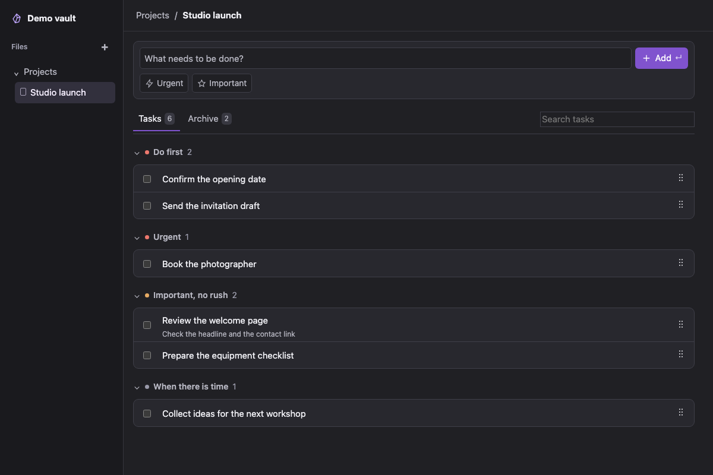

# Zadachi

**Личные списки задач в Obsidian. Каждый список — отдельная заметка Markdown.**

[English](README.md) · Русский

Создавайте отдельные списки для работы, дома и проектов. Открывайте их из проводника в обычных вкладках Obsidian. Задачи остаются в хранилище и читаются как Markdown даже после отключения Zadachi.



На снимках и в демо показан браузерный стенд с вымышленными задачами.

[Установка](#установка) · [Первый список](#первый-список) · [Порядок задач](#порядок-задач) · [Где хранятся задачи](#где-хранятся-задачи)

## Установка

1. Скачайте `zadachi-1.0.0.zip` из [GitHub Releases](https://github.com/bu4ak/zadachi/releases).
2. Распакуйте папку `zadachi` в `<хранилище>/.obsidian/plugins/`. Внутри должны быть `main.js`, `manifest.json` и `styles.css`.
3. Перезапустите Obsidian и включите **Zadachi** в разделе **Настройки → Сторонние плагины**.

В манифесте указан Obsidian 1.8.7 или новее. Самая ранняя версия, проверенная в настольном приложении, — 1.15.1. На мобильном устройстве плагин пока не проверяли.

## Первый список

1. Нажмите правой кнопкой на папку и выберите **Создать список задач**. Эту же команду можно найти в палитре: **Zadachi: Создать список задач**.
2. Введите имя, например **Запуск студии**. Zadachi создаст заметку Markdown в этой папке и откроет список.
3. Введите задачу и нажмите **Enter** или **Добавить**. Кнопки **Срочно** и **Важно** определяют группу приоритета.


[Открыть запись создания списка](docs/media/create-list.gif) и посмотреть ещё раз.

## Порядок задач

Перетащите задачу за ручку из шести точек внутри её группы. Свободное место покажет, куда встанет задача. С клавиатуры выберите ручку и нажмите **Alt + ↑** или **Alt + ↓**. Чтобы сменить группу, нажмите название задачи и измените приоритет.


[Открыть запись перетаскивания](docs/media/reorder.gif) и посмотреть ещё раз.

## Выполнение и поиск

- Нажмите название задачи, чтобы изменить его, приоритет или заметку.
- Отметьте задачу, чтобы переместить её в **Архив**. Снимите отметку в архиве, чтобы вернуть её в **Дела**.
- Удалите одну задачу из архива или очистите архив целиком. После подтверждения удаления кнопка **Отменить** доступна семь секунд.
- Ищите по названию и заметке в текущей вкладке. Нажмите заголовок группы приоритета, чтобы свернуть или раскрыть её.

[Посмотреть архив](docs/media/archive.png).

## Где хранятся задачи

Каждый список — отдельный файл `.md`. Его можно перемещать и переименовывать через проводник Obsidian. Чтобы увидеть исходный текст, выберите **Открыть как Markdown** в меню вкладки. При правке исходника сохраняйте служебные метки.

Если список не открыт, значок Zadachi открывает список по умолчанию. Смените его в **Настройки → Zadachi**. Там же доступны английский, русский и язык Obsidian.

Zadachi читает и записывает файлы внутри хранилища. У плагина нет телеметрии, обязательной учётной записи и автоматических запросов в сеть.

## Сборка

Используйте Node.js 24:

```sh
npm ci
npm test
npm run build
```

Сборка создаёт `main.js` в корне проекта. См. [инструкцию по выпуску](docs/releasing.md).

О проблемах сообщайте в [GitHub Issues](https://github.com/bu4ak/zadachi/issues). Укажите версию Obsidian, платформу и шаги. Для примера используйте вымышленные задачи.

[Лицензия MIT](LICENSE) · [bu4ak](https://github.com/bu4ak)
